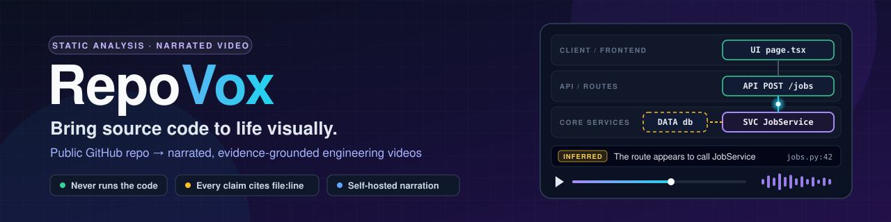
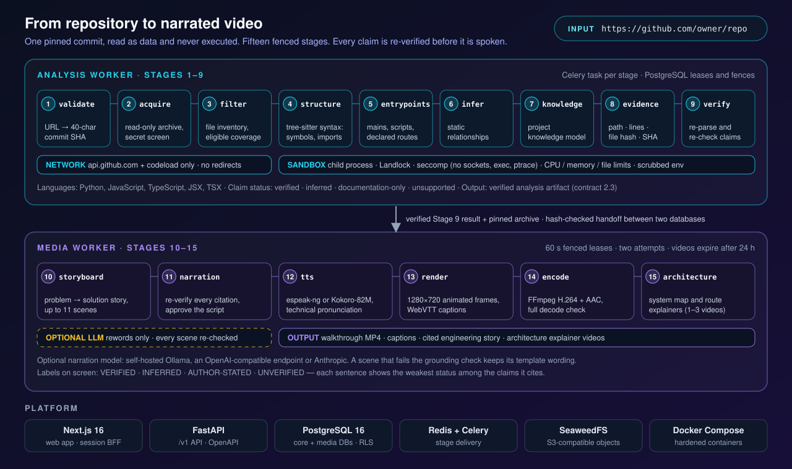
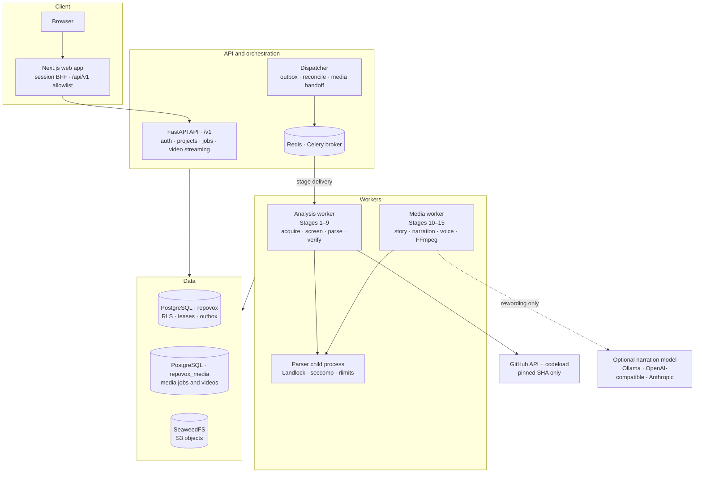

<div align="center">



# RepoVox

**Turn a public GitHub repository into narrated, animated engineering videos. Every technical sentence is cited to a file and line, and nothing in the repository is ever executed.**

[](pyproject.toml)
[](https://www.python.org/)
[](https://fastapi.tiangolo.com/)
[](https://nextjs.org/)
[](https://www.postgresql.org/)
[](https://tree-sitter.github.io/)
[](https://ffmpeg.org/)
[](docs/operations/deployment-guide.md)
[](AGENTS.md)

[Features](#-features) · [Architecture](#-architecture) · [Installation](#-installation) · [Results](#-results) · [Roadmap](#-roadmap) · [Docs](docs/)

</div>

> **Status:** implementation output, not independently reviewed. Public production deployment
> stays gated on an independent security review. The official evaluation corpus is UNFROZEN and
> the independent reviewer appointment is pending; see the
> [sole-contributor policy and phase authority](AGENTS.md).

---

##  Table of Contents

- [The Problem](#-the-problem)
- [The Solution](#-the-solution)
- [Features](#-features)
- [Design Principles](#-design-principles)
- [Architecture](#-architecture)
- [Installation](#-installation)
- [Running the Project](#-running-the-project)
- [Example Output](#-example-output)
- [Results](#-results)
- [Project Structure](#-project-structure)
- [Technologies](#-technologies)
- [Project Maturity](#-project-maturity)
- [Roadmap](#-roadmap)
- [Tests and Quality Gates](#-tests-and-quality-gates)
- [Documentation](#-documentation)
- [Contributing](#-contributing)
- [License](#-license)
- [Contact](#-contact)

---

##  The Problem

Getting to know an unfamiliar codebase is slow. READMEs describe what the authors intended, not
what the code does. Architecture diagrams go stale. AI code explainers will invent a framework,
a benchmark or a feature that isn't there, and say it with confidence. A video walkthrough would
help, but only if every statement in it can be checked.

##  The Solution

A pipeline that reads one pinned commit as data and narrates only what it can back up:

```
GitHub URL → Pin Commit → Screen & Parse (sandboxed) → Verify Claims → Engineering Story → Narrate & Voice → Render & Encode → Videos + Captions + Cited Story
```

It tells the problem-to-solution story the repository documents and draws the architecture the
code actually shows. Every sentence carries a label for how well it is supported: `VERIFIED`,
`INFERRED`, `AUTHOR-STATED` or `UNVERIFIED`. Where the documentation and the code disagree, the
video says so.

##  Features

**Repository Intelligence (Stages 1–9)**
- A public GitHub URL is resolved once to a 40-character commit SHA. Retries reuse the same snapshot, so a moving branch can't change a job
- The archive is fetched read-only from `api.github.com` and `codeload.github.com` only: DNS-pinned TLS, no proxy, no redirects, streaming size and time caps
- **Hostile-archive extraction:** links, devices, path traversal, case collisions and nested archives are rejected. ML weight files (`.pth`, `.pt`, `.keras`) are hashed and skipped instead of failing the repository
- **Secret screening before anything is published.** Provider keys, private keys and literal secrets fail closed; templates such as `${API_KEY}` and placeholder values don't
- Python, JavaScript, TypeScript, JSX and TSX are parsed with tree-sitter in a child process confined by **Landlock**, a **seccomp** filter (no sockets, exec, ptrace, mount or io_uring) and resource limits
- At least 90% of eligible source bytes must parse. Above the 10,000-fact cap only test-file facts are dropped, in fixed tiers, and the omission is stated in the video
- Output is a verified analysis artifact (contract `2.3`) of symbols, relationships, entry points, evidence and claims. The verifier re-parses the original bytes and re-checks every SHA, path, hash and line range

**Problem-to-Solution Engineering Story**
- Up to **eleven adaptive scenes**: introduction, problem, context, proposed solution, development approach, architecture, implementation workflow, technical decisions, demonstrated results, limitations and open questions, conclusion
- Each sentence is labelled with the **weakest status** among the claims it cites
- **Mismatches are stated:** README-only features, mention-only or declared-only technologies, placeholder implementations, unbenchmarked performance claims and architecture claims the code does not support
- An undocumented problem is reported as undocumented. It is never inferred from the repository name
- Tests and examples are never run, and the video says so. Repository lines that address a model ("ignore previous instructions") are counted and never become claims

**Animated System Architecture**
- A whole-repository map in up to **four tiers** (client/frontend, API/routes, core services, ML/data/external) with one cross-tier path animated step by step
- Routes are read from syntax: FastAPI and Flask routers, Express routers and their mounts, Next.js App Router route handlers
- Explainer videos zoom into route services and component graphs: **1–3 architecture videos** per job, alongside the walkthrough
- Every card and arrow carries citations. Solid borders are verified; dashed borders are inferred

**Narration and Voice**
- Deterministic template wording by default, reproducible byte for byte
- **Optional grounded rewording** through self-hosted Ollama, an OpenAI-compatible endpoint or Anthropic. The model sees only the verified scene plan, never a repository file
- A deterministic **claim-by-claim check** refuses invented paths, numbers or technologies, dropped caveats, upgraded certainty and "tests passed" wording. A failing scene keeps its template wording, and the reasons are recorded in the video's metadata
- **Local speech only:** `espeak-ng` by default, or the Kokoro-82M neural voice on CPU through `kokoro-onnx`. No paid speech API
- Technical terms get a spoken pronunciation (`PostgreSQL` → "Postgres Q L", `README` → "Read me", paths read as words). Captions keep the exact text

**Video Pipeline (Stages 10–15)**
- `storyboard → narration → tts → render → encode → architecture`, each stage on a 60-second fenced lease with retries and an attempt limit
- 1280×720 at 30 fps, H.264 + AAC, with on-screen captions and a WebVTT track
- Every encoded file is **fully decoded** to confirm its exact frame count before it is published
- A separate media database (`repovox_media`) with its own roles. Published videos expire 24 hours after the job was created

**Web App and Platform**
- **Next.js dashboard:** sign in, add repositories, start a video job, follow its six stages, then play or download each video with captions and the cited story
- **FastAPI `/v1` API** (28 routes) with a frozen [OpenAPI contract](packages/contracts/openapi.json) that CI checks for drift
- Tenant isolation through PostgreSQL row-level security, CSRF and Origin checks, idempotency keys and per-owner quotas
- Development identities locally; GitHub sign-in for operator-provisioned accounts in production
- **One-command self-hosted deployment** with generated secrets, hardened containers and health checks

##  Design Principles

1. **Read, never run.** Submitted code is data. Nothing is installed, imported, built or tested, and README commands are never executed.
2. **Cite it or don't say it.** Every technical sentence maps to claims with a file, a line range, a file hash and the commit SHA.
3. **Models can reword, never certify.** Verification is deterministic. A language model never assigns a status, and Stage 11 re-checks its wording without calling it again.
4. **Fail closed.** Unsafe settings refuse to start, a suspected secret stops the job, and an unavailable sandbox is an error, never a silent fallback.
5. **Say what's missing.** Undocumented problems, documentation-versus-code mismatches and skipped files are stated in the video, not hidden.
6. **Self-hosted by default.** Normal videos need no paid LLM or TTS API.

##  Architecture



<details>
<summary>Service view (Mermaid)</summary>



</details>

Design records and contracts:
- [Analysis, API and limits](docs/development/analysis.md) for Stages 1–9
- [Architecture explainer](docs/development/architecture-explainer.md) for the architecture videos
- [Media database](docs/operations/media-database.md) for Stages 10–15 and the handoff between the two databases
- [ADR index](docs/adr/README.md): 33 architecture decision records

<!--
##  Screenshots

| Dashboard | Video job progress |
|---|---|
|  |  |

| Walkthrough video | Architecture explainer |
|---|---|
|  |  |
-->

##  Installation

### Requirements

A Linux host on `x86_64` or `aarch64` (WSL 2 works) with:

- Docker Engine and Compose v2
- **Landlock** (ABI 1 or later) and **seccomp** enabled. The parser refuses to run without them
- Outbound HTTPS to `api.github.com` and `codeload.github.com`
- About 4 vCPU and 12 GiB of memory (an estimate, not a benchmark)

The full checklist, with a command to verify each item, is in the
[host prerequisites](docs/operations/deployment-guide.md#1-host-prerequisites).

### Quickstart (self-hosted)

```sh
git clone https://github.com/Stevemeg/RepoVox.git
cd RepoVox
bash scripts/deploy_selfhosted.sh --check   # preflight only; changes nothing
bash scripts/deploy_selfhosted.sh           # generates .env (mode 600), builds, starts and waits for health
# UI: http://localhost:3000 · API: http://127.0.0.1:8000 · API docs: http://127.0.0.1:8000/docs
```

Open `http://localhost:3000` and choose a development identity (Alex Chen or Sam Rivera).
`--mode production` uses GitHub sign-in for provisioned accounts behind a TLS reverse proxy.

### Optional: Kokoro neural voice

Download the reviewed model files into the git-ignored `.models/kokoro/`, then add the
neural-voice overlay:

```sh
bash scripts/setup_kokoro_voice.sh
docker compose -f docker-compose.yml -f infrastructure/local/docker-compose.prod.yml \
  -f infrastructure/local/docker-compose.neural-tts.yml up -d --build --wait
```

### Optional: grounded narration model

Only `media-worker` reads these settings. For a self-hosted Ollama model, add a
`docker-compose.override.yml`:

```yaml
services:
  media-worker:
    extra_hosts: ["host.docker.internal:host-gateway"]
    environment:
      REPOVOX_LLM_PROVIDER: ollama
      REPOVOX_LLM_MODEL: llama3.1:8b          # any model you have pulled
      REPOVOX_LLM_BASE_URL: http://host.docker.internal:11434
```

Ollama must listen on an address the Docker bridge can reach. `openai_compatible` and
`anthropic` also need `REPOVOX_LLM_API_KEY`. Hosted providers receive the
verified story plan (claim text, file paths and the repository name), so use one only where its
terms permit that data; see the [model policy](AGENTS.md#model-policy).

The [self-hosted deployment guide](docs/operations/deployment-guide.md) covers secrets, TLS,
GitHub OAuth, the narration model, backup, upgrade and rollback. Never commit `.env`,
`.artifacts/` or `.models/`; all three are git-ignored.

##  Running the Project

Always run commands from the project root.

```sh
# 1. Start the stack (first run generates .env and waits for health checks)
bash scripts/deploy_selfhosted.sh

# 2. Smoke checks
curl -fsS http://127.0.0.1:8000/health      # {"status":"alive","version":"0.1.0"}
curl -fsS http://127.0.0.1:8000/ready

# 3. In the browser (http://localhost:3000):
#    sign in → add a project with https://github.com/<owner>/<name>
#    → start a video job → follow its stages → play or download the videos
```

**Try it offline with synthetic repositories.** The repository ships locally authored fixtures
(RAG pipeline, GAN, Express service, full-stack TypeScript, microservices and more). Serve them
instead of GitHub, then create a project with `https://github.com/synthetic/<directory>`, such as
`rag_pipeline` or `fullstack_web`:

```sh
SYNTHETIC_SOURCE_DIR=/workspace/tests/fixtures/architectures \
  docker compose up -d --build --wait api worker dispatcher media-worker
```

**Work on the web app** against the running backend:

```sh
docker compose stop web
npm --prefix apps/web ci
REPOVOX_API_URL=http://localhost:8000 npm --prefix apps/web run dev
```

Every browser call goes through the same-origin proxy in
`apps/web/src/app/api/v1/[...path]/route.ts`, which forwards an explicit allowlist of routes. See
the [frontend developer handoff](docs/development/frontend-handoff.md) for the frozen API
contract, polling states and the UI truthfulness rules.

##  Example Output

*Illustrative values. Field names, states, labels and reason codes are the real ones.*

```
VIDEO JOB  GET /v1/video-jobs/{job_id}
 state          awaiting_analysis → queued → running → succeeded
 stages         storyboard ✓  narration ✓  tts ✓  render ✓  encode ✓  architecture ✓
 architecture   published
 videos         walkthrough    h264 + aac · 1280×720 · 30 fps · full_decode: passed
                architecture   system map · deepest backend workflow

NARRATED SENTENCES (label = weakest status among the cited claims)
 [AUTHOR-STATED]  The README states the problem: ...                     README.md:9
 [INFERRED]       The route appears to call JobService.                  backend/app/api/routes/jobs.py
 [UNVERIFIED]     The README reports a speed-up; no benchmark was run.   README.md:24

GROUNDED NARRATION CHECK
 refiner          grounded-llm-refiner-1.0 · provider ollama
 scenes           11 total · 10 refined · 1 fallback
 rejected         "results": ["test_execution_claimed"]
   -> scene keeps its template wording

SPEECH VS CAPTION
 caption          backend/app/services/inputs.py
 spoken           "inputs dot pie in backend app services"
```

##  Results

**Real repositories run through the pipeline.** Each run exposed a defect, and each fix is
recorded in an ADR. These are measurements from development runs, not benchmarks.

| Run | What it exposed | What changed |
|---|---|---|
| `Stevemeg/Synthetic-Data`, merge-commit HEAD | The commit lookup returned 1,147,279 bytes (the JSON embeds every patch), over the 1 MiB metadata cap. Three `.pth` files and one `.keras` file would have been rejected as nested archives | Commit resolved with the SHA media type (64-byte cap); weight files hashed and skipped ([ADR-0028](docs/adr/0028-sha-only-commit-resolution-and-weight-containers.md)) |
| `Stevemeg/Synthetic-Data` at `0c71c556` (215 analysed sources) | All 46 routes sat on `APIRouter` objects in ten files, so the video showed only UI formatting helpers | Whole-repository four-tier system map, built in 0.1 s on that repository ([ADR-0032](docs/adr/0032-whole-repository-system-architecture-view.md)) |
| 9-minute walkthrough at 720p30 on 1 CPU | `libx264 veryfast` took 224.0 s against a 180 s encode deadline | `ultrafast` at CRF 20: 87.6 s on one thread (31.5 s on four), with one full decode for verification ([ADR-0031](docs/adr/0031-neural-voice-and-animated-architecture.md)) |
| Kokoro-82M on CPU | 1.2–1.8× realtime, so a 9-minute story needs about 300–450 s of synthesis against a 240 s speech deadline | A bounded speech cache; the narration stage speaks ahead within its own lease ([ADR-0031](docs/adr/0031-neural-voice-and-animated-architecture.md)) |
| `openai/openai-cs-agents-demo` at `bd7bfca0` | Four defects: a dropped core package, arrows drawn through cards, weak story matches, and speech and frame issues | Sibling-package imports drawn as `INFERRED`, gap routing for arrows, stricter corroboration, clearer pronunciation and story cards ([ADR-0032](docs/adr/0032-whole-repository-system-architecture-view.md#4-review-corrections-2026-11-21)) |

**Engineering footprint**

| Metric | Value |
|---|---|
| Pipeline stages | **15** (9 analysis + 6 media) |
| API surface | **28** `/v1` routes, frozen OpenAPI contract |
| Architecture decision records | **33** |
| Python tests | **741** test functions (666 unit, 75 integration) |
| Web tests | **32** Vitest and Playwright tests |
| CI jobs | Python quality gates, frontend, Compose integration on real PostgreSQL, Redis and S3, Git history secret scan |
| Paid AI APIs needed for a normal video | **0** |

##  Project Structure

```
RepoVox/
├── apps/
│   ├── api/
│   │   ├── repovox/
│   │   │   ├── analysis/        # Stages 1–9: acquire, screen, sandboxed parse, verify
│   │   │   ├── media/           # Stages 10–15: story, narration, speech, frames, encode
│   │   │   ├── api/             # FastAPI /v1 routes
│   │   │   ├── auth/            # Development identities and GitHub OAuth adapter
│   │   │   ├── core/            # Settings with fail-closed validation
│   │   │   ├── services/        # Projects, analysis jobs, media jobs
│   │   │   ├── workers/         # Celery tasks, dispatcher, reconciliation
│   │   │   └── evaluation/      # Evaluation corpus, gold and scoring tooling
│   │   ├── migrations/          # Core database (0004)
│   │   └── migrations_media/    # Media database (m001)
│   └── web/                     # Next.js app: workspace, analysis panel, video panel, API proxy
├── packages/contracts/          # Frozen OpenAPI contract
├── infrastructure/local/        # Dockerfiles and Compose overlays: hardening, neural voice, production
├── infra/aws-retention/         # Disabled CloudFormation for independent retention (never deployed)
├── experiments/offline_media/   # Isolated synthetic source-to-video feasibility spike
├── scripts/                     # deploy_selfhosted.sh, setup_kokoro_voice.sh
├── tests/                       # Unit, integration and operational tests with synthetic fixtures
├── tools/                       # Documentation, contract, security and evaluation tooling
├── docs/                        # Product, architecture, security, operations, ADRs, delivery records
├── docker-compose.yml           # Full local stack
└── AGENTS.md                    # Sole-contributor policy, phase gates and model policy
```

##  Technologies

**Backend:** Python 3.11–3.13 · FastAPI · Pydantic · SQLAlchemy 2 · psycopg 3 · Alembic · Celery · Redis · PostgreSQL 16 (row-level security) · SeaweedFS (S3 API through boto3)

**Analysis:** tree-sitter 0.25 with Python, JavaScript and TypeScript grammars · jsonschema · Landlock and seccomp (libseccomp) process confinement

**Media:** FFmpeg / libx264 · `espeak-ng` · Kokoro-82M through `kokoro-onnx` (ONNX Runtime, CPU) · pure-Python deterministic frame rendering

**Narration (optional):** Ollama · OpenAI-compatible endpoints · Anthropic Messages API, all behind one grounding check

**Frontend:** Next.js 16 · React 19 · TypeScript · Vitest · Testing Library · Playwright

**Tooling:** Docker Compose · GitHub Actions · uv · ruff · mypy (strict) · pytest · pip-audit · gitleaks

##  Project Maturity

**Current capabilities** (implemented; independent review pending)

 Sandboxed static analysis (Stages 1–9) ·  Problem-to-solution engineering story ·  Animated four-tier system architecture ·  Route and component explainer videos ·  Grounded narration with fail-closed fallback ·  Local neural voice (Kokoro-82M) ·  Video pipeline (Stages 10–15) ·  Next.js dashboard ·  GitHub OAuth adapter ·  One-command self-hosted deployment ·  CI quality gates

**Gated or upcoming**

☐ Independent security review before public production deployment · ☐ Independent reviewer appointment and evaluation corpus freeze · ☐ Baseline evaluation of the self-hosted Director model · ☐ Staging reliability verification

##  Roadmap

| Status | Milestone |
|---|---|
|  | Accepted: Phase 0–1 foundation and Phase 2 engineering (SaaS foundation, durable jobs, tenant isolation, sandboxed static analysis through Stage 9) |
|  | Implemented, awaiting independent review: engineering story, animated architecture, grounded narration, neural voice, video Stages 10–15, self-hosted deployment |
|  | Independent security review, required before any public production deployment |
|  | Official evaluation corpus freeze, which needs an appointed independent human reviewer |
|  | Baseline evaluation of the self-hosted Director model, then training-data preparation and specialization |
|  | Staging reliability verification, then real multi-user production |
|  | Deferred: private repositories, branch selection, multilingual voices, higher resolutions |

Detailed roadmap and requirements traceability: **[docs/delivery/roadmap.md](docs/delivery/roadmap.md)**

##  Tests and Quality Gates

CI runs four jobs on pull requests: Python (ruff, mypy strict, unit tests, contract and
documentation checks, pip-audit), frontend (lint, typecheck, tests, build), integration (the
Compose stack with real PostgreSQL row-level security, Redis and S3, plus a Playwright browser
test) and a gitleaks scan of the Git history.

<details>
<summary>Application checks</summary>

First use the [hash-anchored security bootstrap](docs/security/python-trust-remediation.md)
in an owner-selected disposable Python environment. Do not use an old pip or uv for network installation.

```sh
python tools/security_bootstrap.py
uv sync --frozen
uv run ruff check apps/api tests tools/phase1*.py tools/phase2*.py
uv run ruff format --check apps/api tests tools/phase1*.py tools/phase2*.py
uv run mypy
uv run pytest tests/unit -q
uv run python tools/phase1_contracts.py --check
uv run python tools/phase2_contracts.py --check
uv run python tools/phase2_corpus.py docs/ai/evaluation-corpus.manifest.json
uv run python tools/phase2_preparation.py --catalog docs/ai/evaluation-candidates.json --manifest docs/ai/evaluation-corpus.manifest.json
uv run pip-audit --local
npm --prefix apps/web ci
npm --prefix apps/web run lint
npm --prefix apps/web run typecheck
npm --prefix apps/web test
npm --prefix apps/web run build
docker compose -p repovox-test up -d --build postgres redis storage storage-init migrate
docker compose -p repovox-test run --rm --build tests
docker compose -p repovox-test down --volumes
```

Integration tests use an explicitly disposable database with real PostgreSQL row-level
security, Redis and S3 operations. Read [test execution](docs/development/testing.md) before a
destructive test reset.

</details>

<details>
<summary>Documentation checks</summary>

Python 3.11+ and Node.js LTS are used for documentation tooling only:

```powershell
python tools/security_bootstrap.py
python -m pip install -r tools/requirements-docs.txt
python tools/check_docs.py
python tools/cost_model.py --check
python -m unittest discover -s tools -p "test_*.py" -v
$diagramConfig = Join-Path $env:TEMP 'repovox-puppeteer.json'
# Use an installed browser; adjust this path if needed. Config and outputs stay outside Git.
@{ executablePath = 'C:\Program Files\Google\Chrome\Application\chrome.exe' } | ConvertTo-Json | Set-Content -LiteralPath $diagramConfig -Encoding ascii
npx --yes --package @mermaid-js/mermaid-cli@11.15.0 mmdc -p $diagramConfig -i docs/architecture/overview.md -o "$env:TEMP/repovox-architecture.svg"
npx --yes --package @mermaid-js/mermaid-cli@11.15.0 mmdc -p $diagramConfig -i docs/architecture/data-model.md -o "$env:TEMP/repovox-data.svg"
npx --yes --package @mermaid-js/mermaid-cli@11.15.0 mmdc -p $diagramConfig -i docs/ai/director-architecture.md -o "$env:TEMP/repovox-director.svg"
git diff --check
```

Documentation checks validate paths, headings, JSON examples and contract invariants;
Mermaid rendering is separate.

</details>

##  Documentation

Suggested reading order:

1. [Product requirements and acceptance criteria](docs/product/prd.md)
2. [Architecture and diagram](docs/architecture/overview.md)
3. [Intelligence pipeline and artifact contracts](docs/architecture/pipeline.md)
4. [Persistence and job orchestration](docs/architecture/data-model.md)
5. [Security threat model](docs/security/threat-model.md)
6. [Deployment](docs/operations/deployment.md), [reliability](docs/operations/reliability.md) and [cost model](docs/operations/cost-model.md)
7. [Roadmap and requirements traceability](docs/delivery/roadmap.md)
8. [RepoVox Director](docs/ai/director-architecture.md), [model selection](docs/ai/model-selection.md), [training](docs/ai/training-strategy.md), [evaluation](docs/ai/evaluation-plan.md), [self-hosted speech](docs/ai/speech-strategy.md) and [change impact](docs/ai/change-impact.md)
9. [ADRs](docs/adr/README.md) and [targeted remediation verification](docs/delivery/phase0-remediation-verification.md), [revision verification](docs/delivery/phase0-revision-verification.md) ([historical record](docs/delivery/phase0-verification.md))

Self-hosted narration and speech are the primary production strategy. Normal videos need no
paid third-party LLM or TTS API, and external AI evaluation needs explicit owner approval. No
model has been trained or evaluated locally.

##  Contributing

RepoVox is solo-maintained by [Stevemeg](https://github.com/Stevemeg) under the
[sole-contributor policy](AGENTS.md). Bug reports and suggestions are welcome as
[GitHub issues](https://github.com/Stevemeg/RepoVox/issues).

##  License

No open-source license has been published yet. Until a `LICENSE` file is added, all rights are
reserved.

##  Contact

**Kona Bharath Vamshidhar Reddy**<br>
B.E. Artificial Intelligence & Machine Learning · Acharya Institute of Technology<br>
konabharath2004@gmail.com · [LinkedIn](https://www.linkedin.com/in/kona-bharath-vamshidhar-reddy/) · [GitHub](https://github.com/Stevemeg)

---

<div align="center"><sub>Built on one rule: if it can't be cited, it isn't said.</sub></div>
