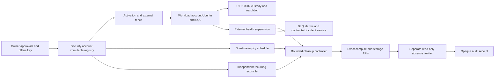

# Independent cloud retention design

Version: `cloud-retention-design-1.0`. Date: 2026-10-20. Proposed, not deployed or
independently accepted. Examples are synthetic. [Decision](../adr/0021-independent-cloud-retention.md) |
[verification](../delivery/cloud-retention-design-verification.md) |
[local custody](../development/custodian-lifecycle.md) |
[signed review](../development/custodian-review.md).

## Provider and guarantee boundary

Recommend AWS provisionally: dedicated disposable workload account, separate
retention/security account, secondary-region read-only health observer. EC2/EBS fit
the existing Ubuntu/POSIX custody; managed scheduling/transactions can supervise it
without a laptop. This is an architecture judgment, not a measured provider ranking.
No alternative has been demonstrated to satisfy the same controls more simply;
a single VPS with a guest cron does not provide independent cleanup authority.

No paid resource, credential, real custodian or protected evidence is created.
The code is a mock-only protocol model, not deployable Lambda/IAM/retention tooling.
Actual cloud adapters and activation integration remain implementation work after
design review and budget approval. Synthetic results do not prove cloud behavior.

Normal monitoring/fencing/cleanup needs neither Windows nor VMware. The owner key
stays on Windows; explicit provisioning/review approvals still need the owner,
but expiry must never require a new signature. No hard deletion-time or forensic
media-erasure guarantee is possible during provider/control-plane/storage outages.

## Components and threat boundaries

- Workload: one attempt at a time, no other tenants/jobs or historical data; pinned
  image/binaries, no submitted-code execution. No public inbound management ports.
- Custodian: UID/GID 10002, zero capabilities, NoNewPrivs, 0700/0600, existing
  lifecycle 1.1 and exact mounts. No routine API/worker receives custody or cleanup
  credentials. Host root/privileged cloud administration remains a trust boundary.
- Security account: registry, conditional state, schedules, cleaner, DLQs/alarms;
  opaque identifiers/commitments only, no source, predictions or private references.
- Verifier: separate read-only cloud role and independently obtained inventories;
  it cannot delete or treat a cleaner's success response as absence evidence.
- Secondary-region observer: opaque health/registry commitments only. No protected
  replica or competing multi-writer fence. Detect primary-region silence externally.
- Contracted incident service: separately approved, audited break-glass access.
  Root/organization compromise, malicious provider administrators and physical SSD
  remnants are not solved by these controls or POSIX/checksum checks.

## Registry and write registration

Immutable root binds owner, tenant, attempt, namespace, approved manifest SHA-256,
original creation/authorization/retention UTC, account/region and cleanup authority.
Each append record binds exact resource ID/ARN, parent, key/version/upload ID,
allowed actions, original root and provisioning-receipt commitment. Deletion state
is separate mutable metadata; it cannot rewrite identities or deadlines.

Pin an exact S3 metadata VersionId/hash and independent owner-approved root anchor.
Object Lock compliance is suitable only for non-sensitive registry/audit versions
with a separately approved audit lifetime. It does not prevent misleading new
versions, so a mutable `latest` pointer is insufficient. See [Object Lock](https://docs.aws.amazon.com/AmazonS3/latest/userguide/object-lock.html).
Mirror only opaque signed metadata. Signatures require actual approved trust keys,
not synthetic owner credentials. Protected payloads must permit early withdrawal.

DynamoDB conditional transactions hold fence generation, resource intents, cleanup
claims and progress. Every mutation checks the exact root/current generation.
Do not use TTL as an expiry clock, Scan/Query as an atomic inventory snapshot or
multi-region last-writer-wins as terminal-state protection. [Transaction isolation](https://docs.aws.amazon.com/amazondynamodb/latest/developerguide/transaction-apis.html)
requires conditional writes and a stable registration head. Unavailable authority
fails closed. The model's SQLite transactions approximate this protocol only.

1. Provision an empty, exactly identified destination with separate short-lived
   infrastructure authority. Commit original expiry and parent registration before
   any bytes, including failed acquisition fragments.
2. Independently verify resource identity and cleanup grants. Commit a durable
   intent with exact opaque key, expected hash/size, tenant and original root.
3. Read back actual expiry schedule, recurring reconcile route, working alarm/DLQ
   and cleanup canary receipts. Fresh local watchdog proof is also mandatory.
   Neither a running instance nor a configured schedule alone permits writes.
4. A provider VersionId/UploadId exists only after creation: do not invent it
   beforehand. Pre-register its exact bucket/key intent; register the returned ID
   before acknowledgment. Recovery enumerates all pages for that key, associates
   exact IDs with the original intent and quarantines ambiguity. Do not repeat Put
   or analysis merely because acknowledgment was lost.
5. Recheck current fences before acknowledgment/publication. Local/registry/provider
   transactions are not a distributed atomic commit; durable intents and quiescence
   cover the gap. Every parent destination must already be retention-controlled.

Tags may detect anomalies but cannot grant deletion authority. Wrong identity,
region/account, tenant, altered/missing root or unknown copy blocks writes and
destruction. Only an independently verified redundant immutable root can recover
authority; never reconstruct it from tags or a guest's claim.

## States, authority and write/delete coordination

Existing SQL claim/scope, local lifecycle/watchdog and a proposed external cloud
gate must all pass. The cloud gate is a future additive adapter, not integrated in
the accepted runner here. It uses at most a 30-second authority window, capped by
original deadlines; stage/write acknowledgment/publication independently recheck.
No cached healthy heartbeat, ordinary retry or instance restart can confer authority.

| State | Meaning |
| --- | --- |
| REGISTERED | Immutable root/resources exist, protected writes prohibited |
| ACTIVE | Verified retention and independently valid execution/review authority |
| FENCED | Irreversible invalidation/withdrawal/health loss; generation increases |
| CLEANING | Due expiry or earlier approved invalidation; short conditional cleaner claim |
| VERIFYING | Requests completed, not yet independent absence proof |
| COMPLETE | Separate verifier proves registered destinations absent; reconciliation continues |
| OVERDUE/INCOMPLETE | Diagnostic unresolved cleanup, never terminal success or disabled reconciliation |

SQL EXECUTION_CLOSED remains distinct: valid owner-signed review may continue only
inside original custody deadlines without reopening execution. No operation renews
retention or authorization. Health recovery permits cleanup, never automatic retry.

At expiry commit external FENCED/generation first, independently of PostgreSQL.
SQL invalidation is attempted when available but cannot block provider containment.
Terminate the exact registered runtime, reconcile termination/attachments, then
delete exact disks. A stopped guest need not cooperate. Never force-detach from an
unidentified live writer. An already issued network write cannot necessarily stop
at the fence instant: refuse its acknowledgment and retain its original intent.
Require terminated writers, revoked/exhausted credentials and no upload paths before
absence verification. Optional S3 deny propagation/in-flight uploads require real
API testing; mock atomic quiescence is explicitly an assumption.

Lock order: conditional registry transaction; commit/release; provider call; fenced
result transaction. Never hold PG/DynamoDB/local filesystem locks across network
calls or acquire them in reverse. Short cleaner leases may expire; original retention
does not. Idempotent calls use the same approved identities. Stale claim generations
cannot publish progress/receipts; crashes recover existing intents, not new resources.

## Cleanup and verification

Use UTC original expiry, flexible window OFF, finite retries and exact DLQ on the
one-time schedule. [Scheduler precision is 60 seconds](https://docs.aws.amazon.com/scheduler/latest/UserGuide/schedule-types.html);
[retry age/attempts are bounded](https://docs.aws.amazon.com/scheduler/latest/APIReference/API_RetryPolicy.html)
at 24 hours/185. Neither means an exact deletion-time guarantee. Independently
reconcile due attempts every minute, and observe that controller every five minutes
from the secondary region. Do not disable recurrence after first invocation or
COMPLETE. Scheduler messages contain an opaque registry commitment, not arbitrary
submitted resource IDs or role ARNs.

1. Verify original root/append head and exact account/region authority; fence first.
2. Durably claim actions and terminate only registered compute. Reconcile long
   operations across bounded invocations, not sleeps until a Lambda timeout.
3. Abort registered multipart uploads, enumerate/recheck parts and all pages.
   [In-flight parts can outlive an Abort](https://docs.aws.amazon.com/AmazonS3/latest/API/API_AbortMultipartUpload.html).
4. Delete exact object versions and delete markers; independently prove the approved
   parent/key inventory empty. A simple Delete in a versioned bucket is only a
   marker, not erasure: [version deletion](https://docs.aws.amazon.com/AmazonS3/latest/userguide/DeletingObjectVersions.html).
5. Delete registered snapshots/recovery points and all registered disks, including
   root, acquisition, DB/object-store. [Attached EBS cannot be deleted](https://docs.aws.amazon.com/ebs/latest/userguide/ebs-deleting-volume.html).
   DeleteOnTermination is helpful, not absence evidence. Recycle Bin, AMI snapshot
   dependencies and backup/vault holds prevent completion and need escalation.
6. Separate read-only verifier enumerates complete approved parents/versions/uploads,
   volumes/snapshots and permitted replicas. AccessDenied, timeout, incomplete
   pagination, wrong endpoint and unknown copies are unresolved, never NotFound.
7. Commit opaque receipt: root/intent-head hashes, original expiry, exact action
   commitments, actual observation times, verifier identity, covered scope and
   unresolved count. A second independent pass and ongoing reconciliation detect
   drift. Provider absence is not a physical media-erasure certificate.

No source/prediction, raw SDK stderr, request body, credential or private key enters
logs/metrics/notifications/DLQs. Fixed allowlisted fields and opaque hashes only;
disable generic request/response tracing. Any diagnostic export itself needs a
bounded, registered destination and payload-screening policy.

## IAM and resource ownership

The [policy preview](cloud-retention-iam.example.json) is synthetic and intentionally
not a complete deployable trust/role configuration. Use the [EC2 authorization table](https://docs.aws.amazon.com/service-authorization/latest/reference/list_ec2.html)
to verify real action/resource support. Destructive resources are exact ARNs; only
read-only Describe actions that cannot be resource-scoped use Resource `*`.

| Principal | Exact authority / boundary |
| --- | --- |
| Infrastructure provisioner | Separately approved short session creates empty named resources, pinned image, encryption, exact policies/schedules/registry; retired before evidence |
| Application/worker | Existing scoped SQL/artifact access; no custody mount, IAM/PassRole, cleanup AssumeRole, registry updates, snapshot/backup/replica or infrastructure creation |
| Custodian | UID 10002, accepted storage/grants only; no broad destructive cloud role, no owner private key |
| Health reporter | Exact CloudWatch metric namespace and authenticated metadata endpoint; PutMetricData constrained by cloudwatch:namespace |
| Registry writer | Conditional exact table/key transactions and append-only named metadata records; cannot amend approved root/version/expiry/owner anchor |
| Scheduler | Exact SourceAccount/SourceArn trust, InvokeFunction on qualified cleaner version and SendMessage on exact DLQ; no direct deletion or unrestricted PassRole |
| Cleaner orchestrator | Read pinned metadata and update exact attempt progress; AssumeRole only exact workload cleanup role with ExternalId/root binding; cannot amend approval/IAM/expiry |
| Per-attempt cleanup role | TerminateInstances exact instance; DeleteVolume exact disks; DeleteSnapshot exact approved snapshots; optional DeleteObjectVersion exact keys/version conditions and AbortMultipartUpload exact keys; no StartInstances/CreateVolume/AttachVolume/RunInstances |
| Read-only verifier | Caller identity and exact Describe/List inventory; no deletion, source GetObject, KMS decrypt or evidence mutation |
| Reconciler/secondary monitor | Read approved registry/due index, invoke exact cleaner and emit opaque health; no resource creation or retention extension |
| Incident service | Contracted audited temporary break-glass authority, approved exact targets and receipts; never standing worker/admin credentials |

Trust requires exact principals/accounts, ExternalId/session binding and bounded
duration. No wildcard principal. SCPs/permission boundaries deny workload changes to
cleanup/schedules/registry and prevent replacement compute or new storage. GitHub
workflow/reviewer/API never obtains destructive credentials. Runtime tags are merely
diagnostic. Actual effective IAM, role grants, service conditions and cross-account
trust need real tests; Python labels do not prove authentication or IAM enforcement.

IAM cannot generally constrain the contents of a submitted bucket policy by hash.
If optional protected S3 writes are introduced, a separately reviewed trusted fencer
may change only one dedicated approved bucket's policy; no generic worker receives
that ability. The EBS-only initial profile avoids that extra component. Returned
version IDs need committed intents and narrowed deletion policies before use.

The concrete action sets for later policy compilation are:

| Interface | Actions / required exact selectors |
| --- | --- |
| Security registry read | s3:GetObjectVersion on pinned metadata keys, s3:VersionId; no source GetObject |
| Conditional state | dynamodb:GetItem, PutItem, UpdateItem, ConditionCheckItem on exact table; LeadingKeys bound to attempt/root, mutation protocol transactional; no app direct grant |
| Due-index reconciliation | dynamodb:Query on exact due index/table plus strong per-attempt reread; scans never confer deletion authority |
| Cross-account delegation | sts:AssumeRole on one exact cleanup role ARN, exact principal/ExternalId; no iam:PassRole |
| Workload cleanup | ec2:TerminateInstances, DeleteVolume; optional DeleteSnapshot on exact approved IDs; ec2:DescribeInstances/Volumes/Snapshots read-only |
| Optional object cleanup | s3:ListBucketVersions, ListBucketMultipartUploads on exact bucket; ListMultipartUploadParts/AbortMultipartUpload on approved keys; DeleteObjectVersion with exact key and s3:VersionId; DeleteBucket only exact empty approved bucket |
| Scheduler delivery | lambda:InvokeFunction exact qualified version, sqs:SendMessage exact DLQ |
| DLQ incident reader | sqs:ReceiveMessage, DeleteMessage, GetQueueAttributes on exact queue, no payload exports |
| Health/notification | cloudwatch:PutMetricData with exact namespace; sns:Publish exact incident topic; no source-derived dimensions |

Names above are an explicit permission specification, not attached policy. DynamoDB
transactions require permissions for their constituent item operations; do not invent
an IAM permission from an API method name. Validate actual condition support before
deployment. Snapshot ARNs have an empty account component; the independent registry
and Describe ownership check still bind the exact owning account. Unexpected backup
service copies have no blanket cleanup grant and block completion until separately
approved. Do not add wildcard backup-vault or snapshot deletion to resolve an incident.

## Every protected-copy destination

| Destination | Required initial treatment |
| --- | --- |
| Primary custody | Registered encrypted volume and independent receipt, unchanged accepted lifecycle and private B |
| Acquisition/archive/extraction | Registered bounded scratch before network; original failed fragments included; no default temp |
| Memory/parser | Sandbox, no core dumps, swap or hibernation; no unregistered memory export; no forensic RAM-erasure claim |
| PG/Redis/object storage | Register all backing volumes/journals/logs; payload logging disabled; no unregistered managed backup |
| Root/container layers/tmp | Register entire disposable root disk even if expected payload-free; bounded registered tmpfs; no unrelated host bind mounts |
| Protected S3 | Initially disabled; optional exact keys/versions/markers/uploads, complete paginated inventory, replication/Object Lock off |
| Snapshots/AMIs/Recycle Bin/Backup | Initially denied and independently checked; any retained copy blocks COMPLETE; enabling needs exact parent/ID/vault/region authorization |
| Replicas/third-party backup | Default deny; every permitted copy needs approved identity and independently tested cleanup |
| Package A | Exact source-only signed handoff; downloads, clipboard, browser/provider caches and reviewer copies are additional destinations |
| B/reference | No export to reviewer, monitor, logs, DLQ, Git or CI; accepted chronology/operation grants remain mandatory |
| Laptop/host exports | Prohibited unless registered and independently deletable without laptop availability; otherwise the new live profile is blocked |
| Registry/audit metadata | Approved opaque bounded lifetime, no source filenames/bodies or prediction contents |

An upload to ChatGPT is not exempt because its source is public. Provider rights,
permitted processing and verifiable retention/deletion require separate approval.
A cloud cleaner cannot erase a third party or a powered-off recipient laptop.
Unmanaged exports block the requested end-to-end guarantee; do not silently broaden
scope. The proposed future profile must resolve this before real source handoff.

## Failure model

D: deterministic refusal within trusted implementation/clock assumptions.
C: conditional eventual provider cleanup. U: external service or real evidence needed.
None implies a hard physical deletion deadline.

| Failure | Behavior and limitation |
| --- | --- |
| Guest crash/power loss | D: no fresh admission; C: terminate/delete registered disks without guest |
| Stopped EC2 | No execution; C: terminate/reconcile attachments/delete exact disks |
| Watchdog termination/stall | D: local gate fails; external missing-progress alarm fences; no analysis restart |
| Missing metrics | Missing is unhealthy, not last-known-good; C: fence/cleanup; U: reporter authenticity |
| Database unavailable | D: SQL work denied; independent fence does not await DB; C: provider cleanup |
| Scheduler failure | Finite retries/DLQ plus separate recurring registry reconciliation |
| Lambda crash/timeout | Durable claim/intent, bounded resume after claim expiry, original deadline unchanged |
| SQS/DLQ failure | Missing-success alarm; reconciliation does not depend on queue; U: incident service |
| IAM regression | AccessDenied is INCOMPLETE; no broader-permission fallback; U: exact permission restoration |
| Altered/deleted manifest | D: pinned version/hash refusal; verified redundant root or overdue escalation, never guessed IDs |
| Control-plane outage | D: new work denied; C: reconcile original expiry after recovery; secondary observer alarms |
| Network partition | D: no uncertain acknowledgment; C/U: API and credential cutoff propagation |
| EBS attached | No success from request; terminate approved runtime and verify detach/absence |
| Object versioning | Exact versions/markers and all pages; no marker-as-erasure |
| Incomplete multipart | Abort/recheck exact key/upload and in-flight parts; uncertainty remains incomplete |
| Snapshots/backups/holds | Initially denied; retained recovery copy prevents completion; U: scoped hold handling |
| Concurrent writes/deletion | D: fence first; C/U: writer quiescence, termination and credential cutoff before absence |
| Duplicate cleaner | Conditional claims/generation; exact idempotent operations; stale receipt publication rejected |
| Cross-tenant/account/region | D: root/receipt/caller mismatch before destructive calls |
| Missing registration | D: no write/export, no tag-derived deletion; U: containment of unknown copies |
| Billing suspension/quota | D: health/gates stop new work; C only after account/API recovery; U: contracted operator |
| Source-only exports | Deny unmanaged copies; cannot claim remote recipient/provider deletion |
| Regional outage | D: no writes; independent region alarms; C: cleanup after primary APIs recover |
| Clock skew | D: future/stale proof refusal; U: clock sync and real deadline tests |
| IAM/root compromise | Outside ordinary-role guarantee; independent accounts/audit reduce blast radius, not administrator proof |

## Monitoring, incident response and availability

Local accepted watchdog freshness remains three seconds for guarded evidence
operations. Proposed cloud checks: 30-second host progress reports, 60-second
external evaluation, missing data breaches after 90 seconds, one-minute due-state
reconciliation and five-minute cross-region monitor-health checks. These are design
targets, not measured end-to-end detection/deletion bounds. Zero progress, future
timestamps, failed API inventory and missing controller success are unhealthy.
Alarm Lambda errors/throttles/age, Scheduler drops, SQS age/DLQ depth, overdue count,
stale reconciliation/verifier and AWS billing/quota events. DLQs are finite evidence,
not permanent incident storage. No protected content in event payloads.

Normal automation is independent of the owner, but permission/billing/provider
failures cannot be resolved by an offline owner or a guest watchdog. An independently
contracted 24/7 service with tested alarm delivery, response objectives, account
recovery authority, provider escalation and audit obligations is mandatory for live
readiness under this requirement. No service has been appointed or priced. Email
delivery is not evidence that a human acknowledged. An SLO is not a hard guarantee.

At every unresolved expiry report overdue duration and exact unresolved destination
count. Keep reconciling after recovery and after apparent success. Never extend the
deadline to hide an outage, turn a timeout into a receipt, or delete unknown targets.

## Bill of materials, caps and shutdown policy

Reference scenario: US East (Northern Virginia), 730 hours/month, one attempt,
up to 30 days (shorter approval wins). Region/residency and rights remain unapproved.
One Ubuntu t3.medium (2 vCPU/4 GiB), Standard credit mode to avoid unbounded surplus
CPU billing, three gp3 disks totaling 70 GB (30 root, 20 private custody/acquisition,
20 DB/object store). Size and performance are assumptions requiring real load tests,
not measured frozen-analyzer throughput. Sequential family execution only.

Two account boundaries, primary plus secondary health region; three bounded Lambda
roles, one expiry schedule, independent recurring triggers, two SQS DLQs, SNS
alarm route, eight custom metrics/ten standard alarms, conditional DynamoDB metadata,
two KMS keys and <=0.1 GB opaque S3 metadata. No GPU, NAT gateway, load balancer,
paid model, protected replicas or snapshots in the initial profile. A public IPv4
egress option has closed inbound rules; private endpoints/NAT are alternative costs
requiring a new quote, not free additions. No anonymous Docker/EC2 endpoint.

The [reproducible cost inputs](cloud-retention-costs.json) and
[calculator](../../tools/phase2_cloud_budget.py) separate published reference prices,
regional worked examples and unknown quotes. No free-tier credit/discount assumed.
They estimate a **known-reference subtotal**, not a complete authorized budget.
SNS, CloudTrail/SSM, data transfer, the exact account/region quote, taxes and the
24/7 incident-service contract remain explicit unknowns. Unknown is not zero.
See [cost-model supplement](cost-model.md#independent-evaluation-retention-costs).

Caps: one instance, 70 GB provisioned disk, 50 MB accepted custody evidence/5000
files under existing bounds, bounded acquisition/DB logs under existing controls,
100 registered cloud resources in the model, no snapshots, <=1 GB outbound planning
volume, <=0.1 GB payload-free logs/month, Lambda reserved concurrency 2 and bounded
60-second invocations, finite DLQ retention and maximum resource registrations.
These are proposed limits, not cloud quotas already applied. A hard cost ceiling
cannot be guaranteed by a delayed billing alarm; resource/IAM caps are the boundary.

Terminate workload resources at expiry/invalidation and release the registered
public address after independent absence checks. Keep external reconciliation and
incident monitoring alive until all destinations are independently absent and the
approved audit/monitoring obligations end. Never use a budget alarm to turn off the
cleaner, delete the registry early or silently abandon overdue data. Unexpected
costs/resources fence admission and trigger independent escalation.

## Synthetic proof and remaining implementation

The offline model implements immutable hashed root metadata, actual SQLite
conditional transactions/durable action intents, monotonic fencing, cleanup claims,
idempotent mock actions, unknown-resource refusal and a separate mock observer.
It contains no AWS SDK, network client, credential loader, protected bytes or live
handler, and rejects REAL mode. Model setup flags are synthetic observations, not
signed activation evidence. Its mock inventory is complete in memory; pagination,
eventual consistency, IAM authenticity and provider quiescence remain unproven.
It does not replace or modify the accepted Store or lifecycle.

Future additive implementation must supply: real pinned-registry verifier and
conditional DynamoDB adapter; exact IAM compiler/trust configuration; authenticated
activation and cloud-fence adapter to the existing executor/custodian; idempotent
EC2/S3 enumerators with pagination; separate verifier; external alarms/reconciler;
registered crash-safe acquisition and export boundaries; staged infrastructure code
that defaults to no deployment. No application database migration is proposed.

Before any real-payload deployment, a separately budgeted disposable cloud test must
prove effective IAM and denied app-role mutations, stopped-instance termination,
EBS detach/DeleteOnTermination/Recycle Bin behavior, snapshot/backup discovery,
version/null-version/marker pagination, in-flight multipart abortion, AccessDenied
versus NotFound, credential-cutoff races, stale Lambda claims, Lambda/database
outage, schedule delivery/DLQ failures, cross-region monitor silence, real alarm
delivery/response and final independent empty inventories. Use synthetic bytes only.
No cloud test is authorized by this document or included in the mock pass count.

## Independent review and deployment prerequisites

- Review architecture, threat/failure matrix, immutable root and conditional fence;
  inspect mock assumptions separately from real guarantees.
- Audit exact IAM actions/ARN formats, cross-account trust, app-role prohibitions,
  worker/reviewer/GitHub isolation and the absence of wildcard destructive grants.
- Approve provider/account/region/residency, retention/audit lifetimes, full copy
  inventory and actual resource receipts; resolve reviewer/provider export policy.
- Appoint/contract an independent 24/7 operator and verify incident delivery,
  acknowledgment, provider/billing recovery, restricted break-glass and deletion
  evidence responsibilities. The owner's lack of availability is not waived.
- Approve a limited synthetic cloud test budget and exact teardown plan before any
  provisioning; approve follow-up adapters/IaC and independently review real results.
- Only then consider separately authorizing a new real attempt. Accepted owner
  enrollment does not authorize deployment, pilot execution or a review grant.

## Historical preservation

Neither historical custodian is accessed, mounted, moved, deleted or migrated here.
Their immutable deadlines remain **2026-11-14 17:43:39 UTC** and
**2026-11-16 16:53:29 UTC**. This proposal provides no retroactive automation.
Historical host-side cleanup remains the owner's separate obligation; inability to
monitor continuously does not extend those deadlines. Historical 0/84 is unchanged
and is not measured 0% analyzer accuracy. EVAL-ENTRY remains UNFROZEN with zero
verified human-reviewed families. No pilot, real A/B, review, reveal or scoring.
